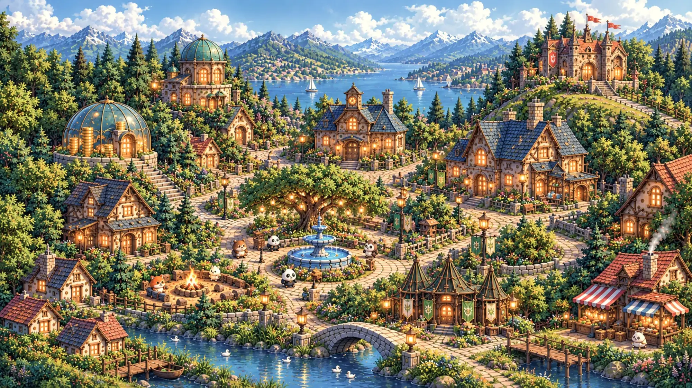
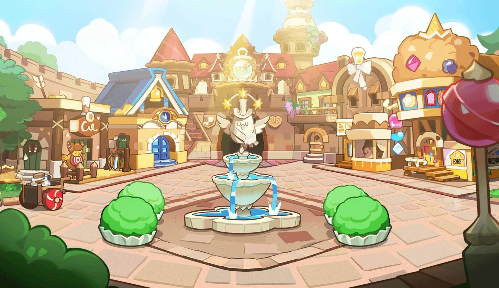
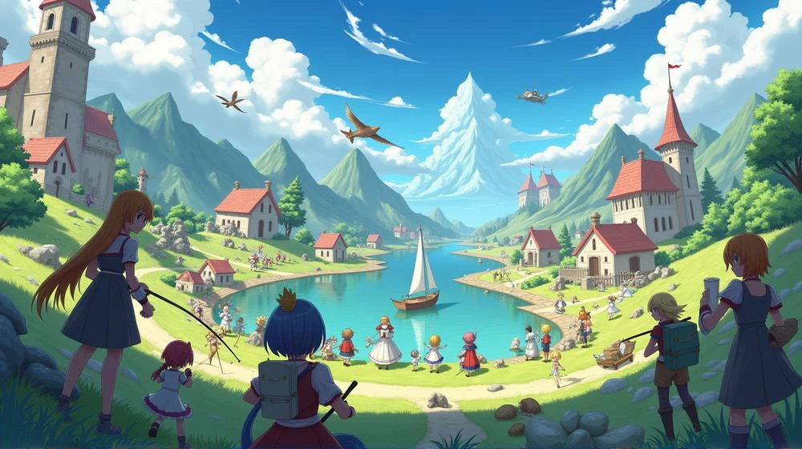
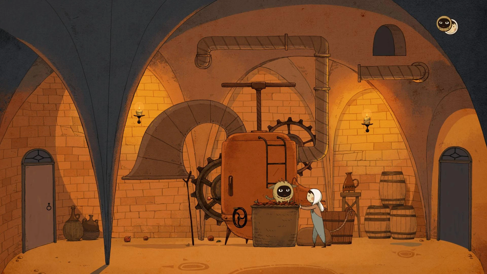

# سند جامع طراحی بازی «رازینو»

**نسخه پیشنهادی محصول تجاری · بازی دوبعدی داستانی و معمایی · اندروید · گروه سنی ۸ تا ۱۲ سال**

> این سند، متن مرجع پروژه است و عیناً از شرح کارفرما ثبت شده است.
>
> - مسیر ذخیرهٔ پروژه: <https://github.com/mojtaba-pourasghar/razino>
> - بازی یک اپ معمولی نیست؛ باید با موتور بازی **Godot 4** کد زده شود، برای **اندروید**.
> - انتخاب فنی برای این محصول: **Godot 4 + GDScript + سیستم محتوای آنلاین نسخه‌بندی‌شده**.

---

هدف این پروژه ساخت یک بازی کامل و قابل فروش است؛ نه یک نمونه نمایشی. بازی باید داستان چندفصلی، شخصیت‌های متحرک، صداگذاری فارسی، انتخاب‌های اثرگذار، ساخت آواتار کارتونی از چهره کاربر و امکان دانلود فصل‌های جدید از سرور داشته باشد.

پیشنهاد من این است که «رازینو» را مانند یک مجموعه انیمیشنی تعاملی بسازیم: بازیکن وارد دنیایی زنده می‌شود، شخصیت خودش را می‌سازد، در صحنه‌ها حرکت می‌کند، با شخصیت‌ها حرف می‌زند، معما حل می‌کند و با انتخاب‌هایش سرنوشت داستان را تغییر می‌دهد.

---

## ۰. مرجع بصری جهان بازی

تصویرهای زیر فضای کامل جهان بازی را که کارفرما تعیین کرده نشان می‌دهند. این‌ها **مرجع سبک و حال‌وهوا** هستند، نه دارایی نهایی و نه چیزی که عیناً کپی شود.

| | مرجع |
|---|---|
| ۱ |  |
| ۲ |  |
| ۳ |  |
| ۴ |  |
| ۵ |  |

**آنچه از این مراجع برداشت می‌شود:**

- نمای کلی شهر: ایزومتریک و پرجزئیات، با خانه‌های سفالی، درختان انبوه، چراغ‌های گرم، آب‌نما و پل سنگی، در کنار دریاچه و کوهستان.
- میدان مرکزی: فضای روشن و دوستانه با آب‌نما، مغازه‌ها و برج ساعت در پس‌زمینه.
- برج ساعت: مکانیزم برنجی، چرخ‌دنده‌ها، لوله‌ها و نور گرم کهربایی — قلب داستان.
- حاشیهٔ شهر: دریاچه، قایق بادبانی، تپه‌ها و آسمان باز.
- زیرزمین: طاق‌های آجری، چرخ‌دنده‌های بزرگ، نور شمع و فضای گرم نارنجی.

---

## ۱. هویت و جهان بازی

### رازینو؛ شهر رازهای گمشده

| | |
|---|---|
| **ژانر** | ماجراجویی دوبعدی، داستان تعاملی، معما و اکتشاف |
| **مخاطب** | کودکان ۸ تا ۱۲ سال |
| **پلتفرم اول** | اندروید، با انتشار در کافه‌بازار و مایکت |
| **سبک بصری** | دوبعدی با کیفیت انیمیشن تلویزیونی، پس‌زمینه‌های چندلایه، شخصیت‌های ریگ‌شده و حرکت‌های نرم |
| **مدل عرضه** | بازی پایه همراه فصل اول؛ فصل‌های بعدی به‌صورت بسته‌های محتوایی قابل دانلود از سرور |

### اصل طراحی

کودک باید بتواند در محیط بازی حرکت کند، اشیاء را بررسی کند، با شخصیت‌ها تعامل داشته باشد، سرنخ جمع کند و در زمان مناسب وارد صحنه‌های داستانی انیمیشنی شود. بازی صرفاً مجموعه‌ای از تصویرهای ثابت و کادرهای دیالوگ نخواهد بود.

### داستان مرکزی مجموعه

در مرکز شهر رازینو، یک برج ساعت قدیمی قرار دارد. این برج زمانی بخشی از یک سامانه اسرارآمیز برای نگهداری خاطرات و تاریخ شهر بوده است. هر بار که یک راز مهم فراموش می‌شود، یکی از نمادهای برج خاموش می‌شود.

گروهی از کودکان به سرنخ‌هایی دست پیدا می‌کنند که نشان می‌دهد ده راز تاریخی شهر به هم مرتبط‌اند. بازیکن در نقش عضو تازه گروه، به همراه **آراد، رها، مانی و فندق**، باید این رازها را کشف کند.

در هر فصل یک پرونده مستقل حل می‌شود؛ اما سرنخ‌هایی از معمای بزرگ‌تر به دست می‌آید. پایان فصل دهم، پاسخ نهایی را ارائه می‌کند و در عین حال ساختار داستان را برای فصل‌های بعدی باز نگه می‌دارد.

> **نکته داستانی:** رازها ماورایی و ترسناک نیستند؛ محور آن‌ها اختراع‌های قدیمی، رمزها، تاریخ شهر، سوءتفاهم‌ها، طبیعت و تصمیم‌های انسانی است. تعلیق برای این گروه سنی باید هیجان‌انگیز اما امن باشد.

---

## ۲. ساختار کامل ده فصل

هر فصل یک داستان کامل با شروع، بحران، کشف و پایان دارد. در کنار آن، یک سرنخ اصلی به داستان کل مجموعه اضافه می‌شود.

### فصل ۱ — راز ساعت خاموش
*آموزش و ورود به بازی*

ساعت برج شهر پس از سال‌ها به صدا درمی‌آید. تکه‌ای نقشه درون آن پیدا می‌شود. بازیکن شخصیت خود را می‌سازد، گروه را می‌شناسد و یاد می‌گیرد چگونه حرکت کند، اشیاء را بررسی کند و سرنخ‌ها را ثبت کند.

- **مراحل:** حیاط مدرسه، راهروی قدیمی، کتابخانه، اتاق زیرشیروانی و برج ساعت.
- **پایان:** یک نشان ناشناس با نماد ده پرتو پیدا می‌شود.

### فصل ۲ — کتابخانه هزار در
*جست‌وجو و رمزگشایی*

کتابی که نقشه قدیمی شهر را در خود دارد ناپدید شده است. گروه باید از روی نشانه‌های کتاب‌ها، ترتیب قفسه‌ها و یادداشت‌های یک کتابدار بازنشسته، مسیر مخفی را پیدا کند.

- **مراحل:** سالن کتاب‌ها، اتاق اسناد، بخش نقشه‌ها و راهروی قفسه‌های متحرک.
- **پایان:** نام مخترعی پیدا می‌شود که در طراحی برج ساعت نقش داشته است.

### فصل ۳ — جنگل نشانه‌ها
*اکتشاف و حل معما*

نقشه گروه را به جنگلی در حاشیه شهر می‌رساند. نشانه‌های روی سنگ‌ها به ترتیب خاصی قرار دارند. بازیکن باید مسیر امن را انتخاب کند و با مشاهده محیط، راه عبور از رودخانه را بیابد.

- **مراحل:** اردوگاه، مسیر سنگی، پل چوبی، آبشار و کلبه متروکه.
- **پایان:** بخشی از یک دستگاه قدیمی در کلبه پیدا می‌شود.

### فصل ۴ — کارگاه مخترع
*ساخت و آزمایش*

گروه به کارگاه مخترع می‌رسد. مانی می‌فهمد دستگاه قدیمی فقط با تنظیم درست چرخ‌دنده‌ها کار می‌کند. بازیکن قطعات را جابه‌جا می‌کند و یک وسیله کوچک برای بازکردن صندوقچه می‌سازد.

- **مراحل:** انبار قطعات، میز طراحی، آزمایشگاه کوچک و اتاق دستگاه‌ها.
- **پایان:** نقشه‌ای از شبکه زیرزمینی شهر ظاهر می‌شود.

### فصل ۵ — راز دریاچه آبی
*مشاهده علمی*

یکی از مسیرهای دستگاه به ایستگاه پژوهشی کنار دریاچه می‌رسد. گروه باید علت تغییر رنگ آب در یک بخش را بررسی کند. معماها درباره نور، بازتاب، زنجیره علت و معلول و مشاهده دقیق‌اند.

- **مراحل:** اسکله، آزمایشگاه آب، تونل شیشه‌ای و سکوی اندازه‌گیری.
- **پایان:** پیام صوتی مخترع درباره ده نماد برج پیدا می‌شود.

### فصل ۶ — جشن هزار چراغ
*گفت‌وگو و تصمیم‌گیری*

در جشن سالانه شهر، گروه متوجه می‌شود که چند وسیله تاریخی اشتباه در غرفه‌ها قرار گرفته‌اند. بازیکن باید از شاهدان سؤال کند، اطلاعات متناقض را تشخیص دهد و با تصمیم خود از متهم‌شدن اشتباه یک شخصیت جلوگیری کند.

- **مراحل:** میدان جشن، بازارچه، غرفه صنایع دستی و صحنه اصلی.
- **پایان:** هویت نگهبان سابق برج آشکار می‌شود.

### فصل ۷ — رصدخانه ستاره‌ها
*الگو و منطق*

گروه به رصدخانه بالای تپه می‌رود. یک نقشه ستاره‌ای و مجموعه‌ای از زمان‌ها نشان می‌دهند که نمادهای برج بر اساس الگویی دقیق مرتب شده‌اند.

- **مراحل:** راه کوهستان، اتاق تلسکوپ، تالار نقشه‌ها و گنبد رصدخانه.
- **پایان:** گروه می‌فهمد ده نماد، بخش‌های یک دستگاه واحدند.

### فصل ۸ — شهر زیر شهر
*اکتشاف پیشرفته*

در زیرزمین شهر، راهروهایی قدیمی وجود دارد. گروه باید مسیرها را روی نقشه ثبت کند، دریچه‌ها را فعال کند و از خطرهای ساده محیطی عبور کند.

- **مراحل:** ورودی تونل، اتاق نقشه، پلکان سنگی و تالار مرکزی.
- **پایان:** یک پیام قدیمی نشان می‌دهد چرا دستگاه برج از کار افتاده است.

### فصل ۹ — ده کلید
*ترکیب سرنخ‌ها*

گروه باید اطلاعات جمع‌آوری‌شده از فصل‌های قبل را کنار هم بگذارد. هر نماد یک بخش از دستگاه را فعال می‌کند و انتخاب ترتیب فعال‌سازی روی مسیر رسیدن به اتاق نهایی اثر می‌گذارد.

- **مراحل:** تالار نمادها، اتاق کلیدها، سکوی دستگاه و ورودی محفظه مرکزی.
- **پایان:** درِ اتاق اصلی باز می‌شود؛ اما دستگاه بدون یک قطعه مهم کار نمی‌کند.

### فصل ۱۰ — قلب رازینو
*پایان داستان اصلی*

گروه با آخرین معما روبه‌رو می‌شود. مشخص می‌شود مخترع دستگاه قصد نداشته رازها را برای همیشه پنهان کند؛ او سامانه‌ای ساخته بود تا تاریخ شهر حفظ شود و هر نسل بتواند با کشف و همکاری، آن را دوباره فعال کند.

بازیکن تصمیم می‌گیرد چگونه دانش کشف‌شده را به شهر منتقل کند و چه کسی مسئول نگهداری آرشیو جدید باشد.

- **پایان:** برج ساعت دوباره روشن می‌شود و در آخرین صحنه، نقشه‌ای تازه از منطقه‌ای ناشناخته ظاهر می‌شود. این نقشه مقدمه فصل‌های آینده است.

> این ده فصل، خط اصلی روایت را تشکیل می‌دهند. برای تبدیل آن به بازی کامل، هر فصل باید به صحنه‌های قابل بازی، دیالوگ‌های دقیق، معماهای پیاده‌سازی‌شده، انیمیشن‌ها، صداها، شرایط انتخاب و پایان‌های مشخص شکسته شود.

---

## ۳. چرخه بازی

هر مرحله از بازی باید یک چرخه روشن داشته باشد:

1. ورود به محیط و نمایش انیمیشن کوتاه ورود.
2. حرکت آزاد در محدوده مرحله و بررسی اشیاء.
3. صحبت با شخصیت‌ها و دریافت سرنخ.
4. حل معما یا انتخاب مسیر.
5. نمایش واکنش شخصیت‌ها و نتیجه تصمیم.
6. ثبت پیشرفت و بازشدن مسیر بعدی.
7. نمایش میان‌پرده انیمیشنی در نقاط مهم داستان.

بازیکن باید در بیشتر محیط‌ها امکان حرکت به چپ و راست، تعامل با اشیاء، ورود به بعضی ساختمان‌ها و بازگشت به مکان‌های قبلی را داشته باشد. بخش‌هایی که صرفاً برای روایت هستند، می‌توانند به‌صورت صحنه‌های سینمایی اجرا شوند.

---

## ۴. انیمیشن‌ها و حرکت شخصیت‌ها

### فهرست انیمیشن‌های ضروری

| دسته | انیمیشن‌ها |
|---|---|
| حرکت پایه | ایستادن، راه‌رفتن، دویدن، توقف، چرخیدن |
| تعامل | اشاره، برداشتن شیء، بازکردن در، بررسی سرنخ |
| گفت‌وگو | حرف‌زدن، گوش‌دادن، پلک‌زدن، حرکت سر و دست |
| واکنش | تعجب، شادی، نگرانی ملایم، فکرکردن، خنده |
| معما | بررسی نقشه، چیدن قطعات، فعال‌کردن دستگاه |
| پاداش | بازشدن صندوق، پیدا‌شدن سرنخ، تکمیل مأموریت |
| سینمایی | ورود شخصیت، تغییر دوربین، نمایش کشف مهم، پایان فصل |

برای هر شخصیت اصلی باید حالت‌های چهره مستقل طراحی شوند. حرکت لب‌ها می‌تواند با صدای از پیش ضبط‌شده هماهنگ شود؛ لازم نیست برای هر دیالوگ انیمیشن کامل و پرهزینه ساخته شود.

### انیمیشن ابتدای فصل

هر فصل با یک میان‌پرده حدود **۲۰ تا ۴۵ ثانیه‌ای** شروع می‌شود:

- نمایی از محیط فصل؛
- حرکت دوربین به سمت نقطه مهم؛
- نمایش شخصیت‌های حاضر؛
- وقوع اتفاق آغازگر داستان؛
- نمایش عنوان فصل و ورود به مرحله قابل بازی.

مدت دقیق باید با ریتم داستان تنظیم شود و امکان ردکردن میان‌پرده برای کاربری که قبلاً آن را دیده فراهم باشد.

### میان‌پرده‌های حین بازی

در نقاط مهم، بازی از کنترل آزاد به روایت سینمایی منتقل می‌شود. برای مثال، هنگامی که ساعت برج روشن می‌شود، دوربین به سمت برج حرکت می‌کند، چرخ‌دنده‌ها شروع به چرخش می‌کنند، نور از پنجره‌ها عبور می‌کند و شخصیت‌ها واکنش نشان می‌دهند.

پس از پایان میان‌پرده، کنترل به بازیکن برمی‌گردد. این انتقال باید نرم باشد و وضعیت بازی، انتخاب‌های قبلی و محل قرارگیری شخصیت را حفظ کند.

### حرکت دوربین و عمق محیط

برای محیط دوبعدی با ظاهر غنی، پیشنهاد من استفاده از چند لایه تصویری است:

- لایه پس‌زمینه دور؛
- ساختمان‌ها و اشیای میانی؛
- مسیر حرکت شخصیت؛
- اشیای نزدیک دوربین؛
- افکت‌های محیطی مانند برگ، گردوغبار، باران ملایم و نور.

با حرکت دوربین، لایه‌ها با سرعت متفاوت جابه‌جا می‌شوند؛ این تکنیک **پارالاکس** نام دارد و حس عمق ایجاد می‌کند، بدون اینکه نیاز به ساخت محیط سه‌بعدی داشته باشیم.

---

## ۵. تبدیل چهره کاربر به شخصیت کارتونی

این قابلیت می‌تواند یکی از ویژگی‌های جذاب بازی باشد، اما چون مخاطب کودک است، باید از ابتدا با طراحی حریم خصوصی همراه شود.

### جریان کار از دوربین تا ورود به بازی

**مرحله ۱ — عکس اختیاری**
والد یا کودک با تأیید والد، دوربین را باز می‌کند و یک عکس روبه‌رو می‌گیرد.

**مرحله ۲ — تشخیص اجزای چهره**
موقعیت چشم‌ها، ابروها، بینی، دهان و محدوده صورت برای ساخت آواتار تخمین زده می‌شود.

**مرحله ۳ — کارتونی‌سازی**
ویژگی‌های صورت به سبک هنری اختصاصی بازی تبدیل می‌شوند؛ مو، رنگ‌ها، فرم چهره و حالت چشم‌ها با قالب کارتونی هماهنگ می‌شوند.

**مرحله ۴ — ساخت شخصیت بازی**
آواتار روی بدن کارتونی بازی قرار می‌گیرد، لباس انتخاب می‌شود و شخصیت وارد صحنه‌های داستانی می‌شود.

### بهترین روش فنی برای ساخت آواتار

دو روش داریم:

**روش اول: آواتار کارتونی پارامتری روی دستگاه**
سیستم از روی ویژگی‌های ساده چهره، یکی از اجزای کارتونی طراحی‌شده را انتخاب می‌کند: فرم صورت، چشم، ابرو، مو و رنگ پوست. این روش سریع‌تر، کم‌هزینه‌تر و از نظر حریم خصوصی بهتر است. عکس اصلی می‌تواند روی دستگاه پردازش شود و اصلاً به سرور ارسال نشود.

**روش دوم: تبدیل تصویر به تصویر با مدل هوش مصنوعی**
مدل تصویری، عکس را به سبک کارتونی اختصاصی بازی تبدیل می‌کند. این روش ممکن است شباهت بصری بیشتری ایجاد کند، اما کیفیت و ثبات خروجی تضمین‌شده نیست؛ به‌ویژه وقتی بخواهیم آواتار در حالت‌های مختلف و انیمیشن‌های متعدد یکسان باقی بماند. همچنین به زیرساخت پردازشی، کنترل کیفیت و تدابیر جدی‌تر حریم خصوصی نیاز دارد.

### پیشنهاد من برای رازینو

در نسخه تجاری، ابتدا یک سیستم آواتارسازی پارامتری باکیفیت بسازیم و عکس را فقط برای استخراج ویژگی‌های لازم به‌کار ببریم. اگر تبدیل مستقیم تصویر با هوش مصنوعی اضافه شد، باید قابلیت اختیاری و جداگانه باشد، با رضایت معتبر والدین و سیاست روشن درباره نگهداری داده‌ها.

- ذخیره عکس اصلی به‌صورت پیش‌فرض ممنوع باشد.
- در صورت پردازش سروری، ارسال عکس به‌صورت اختیاری، با اطلاع‌رسانی و رضایت والدین انجام شود.
- عکس و فایل‌های موقت بلافاصله پس از ساخت آواتار حذف شوند؛ حذف باید در سرور نیز قابل تأیید باشد.
- عکس چهره نباید برای تشخیص هویت، ردیابی کاربر یا آموزش مدل استفاده شود، مگر در چارچوبی مستقل و با رضایت صریح و معتبر که برای این محصول توصیه نمی‌کنم.
- کاربر باید همیشه بتواند بدون عکس، از آواتارهای آماده استفاده کند.

> **محدودیت مهم:** تشخیص نقاط صورت به‌تنهایی تصویر را کارتونی نمی‌کند. برای خروجی حرفه‌ای باید یک مدل کارتونی‌سازی یا سیستم طراحی اجزای چهره به آن متصل شود. همچنین اگر قرار است صورت در طول انیمیشن‌ها تغییر حالت دهد، مدل چهره باید با ریگ و حالت‌های صورت سازگار باشد.
